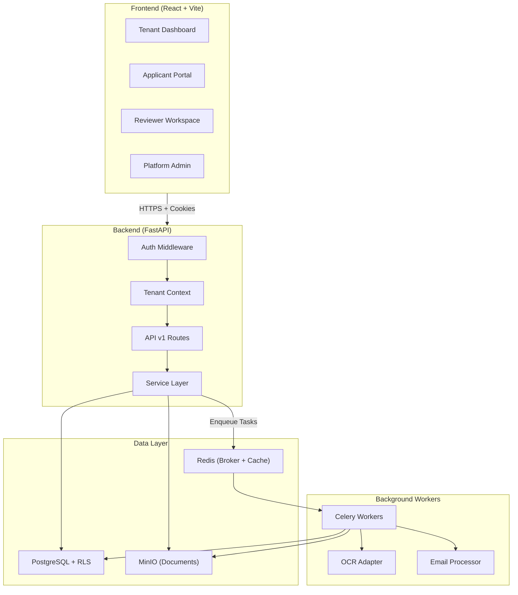
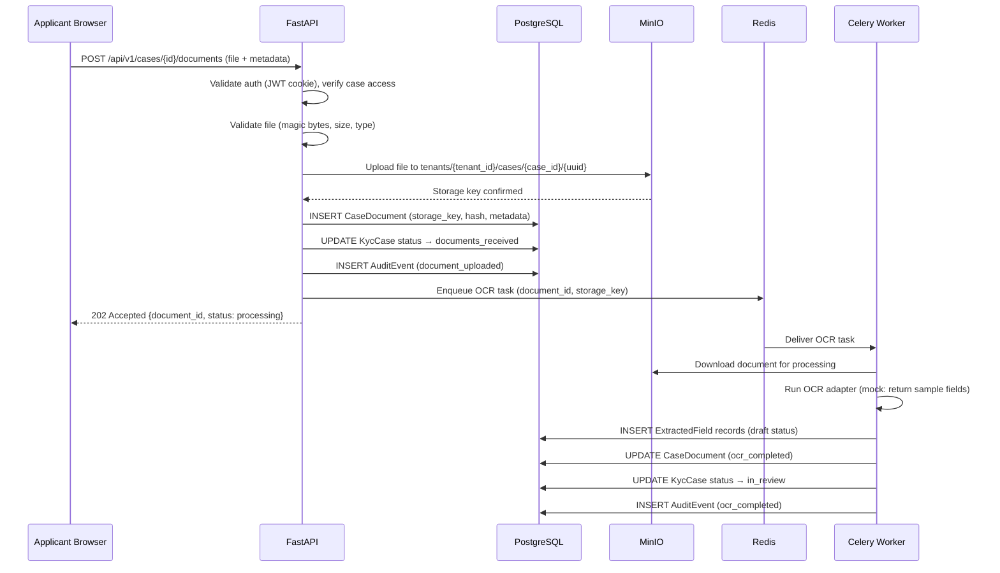
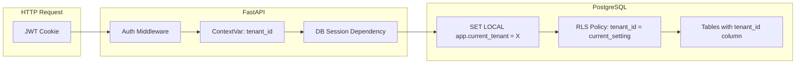
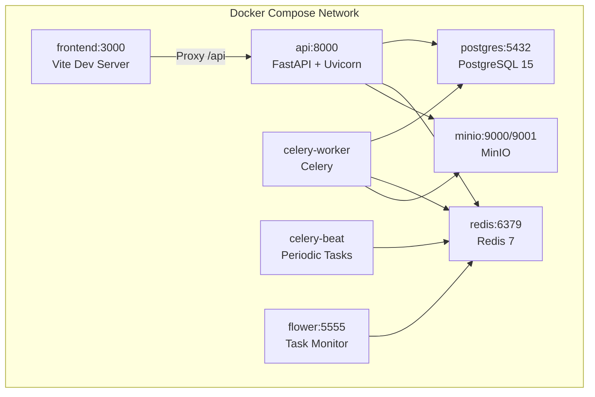

# System Architecture

## High-Level Overview

The CKYC Marketplace is a multi-tenant SaaS application with a clear separation between the API layer, background processing, and object storage.



---

## Component Responsibilities

### Frontend (React + TypeScript + Vite)

| Component | Purpose |
|---|---|
| **Auth Module** | Login, session management, tenant switching |
| **Dashboard** | Case list with filters, metrics cards, search |
| **Case Detail** | Document viewer, OCR field display, review actions |
| **Applicant Portal** | Invitation landing, document upload, consent flow |
| **Reviewer Workspace** | Side-by-side document + extracted fields, approve/reject |
| **Admin Panel** | Tenant list, user management, usage metrics |

### Backend (FastAPI)

| Layer | Responsibility |
|---|---|
| **API Endpoints** | HTTP request handling, input validation, response formatting |
| **Auth Middleware** | JWT verification, session management, CSRF checking |
| **Tenant Context** | Extract tenant ID from JWT, inject into DB session via `ContextVar` |
| **Service Layer** | Business logic, state machine enforcement, audit logging |
| **Models** | SQLAlchemy 2.x ORM models with `TenantMixin` |
| **Schemas** | Pydantic v2 request/response validation |

### Background Workers (Celery)

| Worker | Purpose |
|---|---|
| **OCR Processor** | Receives document storage key → runs OCR adapter → saves ExtractedFields |
| **Email Ingester** | Polls/imports email → matches to case → saves attachments |
| **Notification Worker** | Sends invitation notifications (mock in dev) |
| **Cleanup Worker** | Handles document retention/expiry (Phase 2) |

### Data Layer

| Service | Purpose | Key Config |
|---|---|---|
| **PostgreSQL 15+** | Application data, RLS policies | Two roles: `app_owner` (migrations), `app_user` (runtime) |
| **Redis 7** | Celery broker, result backend, rate limit counters | DB 0 = broker, DB 1 = results, DB 2 = cache |
| **MinIO** | Private document storage | SSE-S3 encryption, private bucket policy |

---

## Request Flow — Document Upload Example



---

## Multi-Tenancy Architecture

### Strategy: Shared Database with Row-Level Security

All tenants share the same PostgreSQL tables. Security is enforced at the database level via RLS policies.



### Why RLS?

| Approach | Pros | Cons |
|---|---|---|
| **Manual filter** | Simple | Human error → data leaks |
| **Schema-per-tenant** | Strong isolation | Migration nightmare at scale |
| **RLS (chosen)** | DB-enforced, simple queries | Requires careful role setup |

### Defense-in-Depth

Even with RLS, we add application-level filters as a secondary safeguard:

1. **Database Level**: PostgreSQL RLS policies block cross-tenant reads/writes
2. **Application Level**: `TenantMixin` adds `.filter(tenant_id=ctx.tenant_id)` to queries
3. **API Level**: Endpoint dependencies verify tenant membership
4. **Storage Level**: MinIO paths namespaced by tenant: `tenants/{tenant_id}/...`
5. **Cache Level**: Redis keys namespaced: `tenant:{tenant_id}:...`
6. **Worker Level**: Celery tasks receive explicit `tenant_id` in payload

---

## Docker Compose Architecture



### Service Dependencies (Health Checks)

```
postgres  ← api, celery-worker, celery-beat
redis     ← api, celery-worker, celery-beat, flower
minio     ← api, celery-worker
```

All services use health checks with `depends_on: condition: service_healthy` to ensure proper startup order.

---

## Technology Decision Records

### Why FastAPI + SQLAlchemy 2.x (Async)?
- FastAPI provides automatic OpenAPI docs, excellent Pydantic integration, and high performance
- SQLAlchemy 2.x supports async natively via `asyncpg`, avoiding the need for `databases` library
- Both are mature, well-documented, and widely adopted

### Why Celery over FastAPI BackgroundTasks?
- OCR processing is CPU-bound and can take 10-60+ seconds
- Celery provides retry logic, dead letter queues, task monitoring (Flower), and horizontal scaling
- BackgroundTasks would block the API process

### Why MinIO over local filesystem?
- S3-compatible API works identically in production (AWS S3, GCS, Azure Blob)
- Pre-signed URLs enable secure direct browser downloads without proxying
- Supports server-side encryption (SSE-S3/SSE-KMS) natively
- Docker image available for local development

### Why Radix UI + Tailwind CSS?
- Radix provides accessible, unstyled primitives (dialogs, dropdowns, tabs)
- Tailwind enables rapid UI development without CSS context switching
- Together they produce a clean, professional UI without heavy component library overhead

### Why TanStack Query v5?
- Eliminates manual loading/error state management
- Built-in caching, stale-while-revalidate, and optimistic updates
- Query key factories enable granular cache invalidation
- `placeholderData` prevents flickering during pagination
