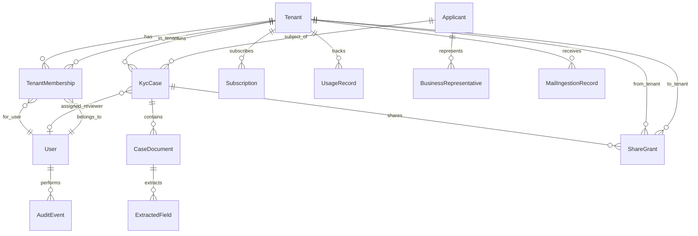

# Data Model & Database Design

## Entity-Relationship Diagram



---

## Model Definitions

### Tenant

```python
class Tenant(Base):
    __tablename__ = "tenants"
    
    id: Mapped[uuid.UUID] = mapped_column(UUID, primary_key=True, default=uuid.uuid4)
    name: Mapped[str] = mapped_column(String(200), nullable=False)
    slug: Mapped[str] = mapped_column(String(100), unique=True, nullable=False)
    status: Mapped[str] = mapped_column(
        String(20), nullable=False, default="active"
    )  # active, suspended, archived
    plan: Mapped[str] = mapped_column(String(50), nullable=False, default="free")
    created_at: Mapped[datetime] = mapped_column(DateTime(timezone=True), server_default=func.now())
    updated_at: Mapped[datetime] = mapped_column(DateTime(timezone=True), onupdate=func.now())
    
    # Relationships
    memberships: Mapped[list["TenantMembership"]] = relationship(back_populates="tenant")
    cases: Mapped[list["KycCase"]] = relationship(back_populates="tenant")
    subscriptions: Mapped[list["Subscription"]] = relationship(back_populates="tenant")
```

### User

```python
class User(Base):
    __tablename__ = "users"
    
    id: Mapped[uuid.UUID] = mapped_column(UUID, primary_key=True, default=uuid.uuid4)
    email: Mapped[str] = mapped_column(String(255), unique=True, nullable=False, index=True)
    hashed_password: Mapped[str] = mapped_column(String(255), nullable=False)
    full_name: Mapped[str] = mapped_column(String(200), nullable=False)
    is_active: Mapped[bool] = mapped_column(Boolean, default=True)
    is_platform_admin: Mapped[bool] = mapped_column(Boolean, default=False)
    created_at: Mapped[datetime] = mapped_column(DateTime(timezone=True), server_default=func.now())
    
    # Relationships
    memberships: Mapped[list["TenantMembership"]] = relationship(back_populates="user")
```

> [!NOTE]
> Users are NOT tenant-scoped. A user can belong to multiple tenants via `TenantMembership`. Platform admins have `is_platform_admin=True` and operate outside tenant scope.

### TenantMembership

```python
class TenantMembership(Base):
    __tablename__ = "tenant_memberships"
    
    id: Mapped[uuid.UUID] = mapped_column(UUID, primary_key=True, default=uuid.uuid4)
    user_id: Mapped[uuid.UUID] = mapped_column(UUID, ForeignKey("users.id"), nullable=False)
    tenant_id: Mapped[uuid.UUID] = mapped_column(UUID, ForeignKey("tenants.id"), nullable=False)
    role: Mapped[str] = mapped_column(
        String(30), nullable=False
    )  # tenant_admin, reviewer
    status: Mapped[str] = mapped_column(
        String(20), nullable=False, default="active"
    )  # active, suspended, invited
    created_at: Mapped[datetime] = mapped_column(DateTime(timezone=True), server_default=func.now())
    
    # Unique constraint: one role per user per tenant
    __table_args__ = (
        UniqueConstraint("user_id", "tenant_id", name="uq_user_tenant"),
    )
    
    # Relationships
    user: Mapped["User"] = relationship(back_populates="memberships")
    tenant: Mapped["Tenant"] = relationship(back_populates="memberships")
```

### Applicant (Polymorphic)

```python
class ApplicantType(str, Enum):
    PERSON = "person"
    BUSINESS = "business"

class Applicant(Base):
    __tablename__ = "applicants"
    
    id: Mapped[uuid.UUID] = mapped_column(UUID, primary_key=True, default=uuid.uuid4)
    tenant_id: Mapped[uuid.UUID] = mapped_column(UUID, ForeignKey("tenants.id"), nullable=False, index=True)
    applicant_type: Mapped[str] = mapped_column(String(20), nullable=False)
    email: Mapped[Optional[str]] = mapped_column(String(255), nullable=True)
    phone: Mapped[Optional[str]] = mapped_column(String(50), nullable=True)
    created_at: Mapped[datetime] = mapped_column(DateTime(timezone=True), server_default=func.now())
    
    # Person-specific fields (null for business)
    first_name: Mapped[Optional[str]] = mapped_column(String(100), nullable=True)
    last_name: Mapped[Optional[str]] = mapped_column(String(100), nullable=True)
    date_of_birth: Mapped[Optional[date]] = mapped_column(Date, nullable=True)
    nationality: Mapped[Optional[str]] = mapped_column(String(100), nullable=True)
    
    # Business-specific fields (null for person)
    business_name: Mapped[Optional[str]] = mapped_column(String(300), nullable=True)
    registration_number: Mapped[Optional[str]] = mapped_column(String(100), nullable=True)
    incorporation_date: Mapped[Optional[date]] = mapped_column(Date, nullable=True)
    
    # Relationships
    cases: Mapped[list["KycCase"]] = relationship(back_populates="applicant")
    representatives: Mapped[list["BusinessRepresentative"]] = relationship(back_populates="business")
```

> [!TIP]
> **Single-table approach over joined-table inheritance for MVP.** Using one `applicants` table with nullable fields is simpler for migrations, queries, and early development. Switch to polymorphic inheritance if the person/business models diverge significantly in later phases.

### BusinessRepresentative

```python
class BusinessRepresentative(Base):
    __tablename__ = "business_representatives"
    
    id: Mapped[uuid.UUID] = mapped_column(UUID, primary_key=True, default=uuid.uuid4)
    tenant_id: Mapped[uuid.UUID] = mapped_column(UUID, nullable=False, index=True)
    business_id: Mapped[uuid.UUID] = mapped_column(UUID, ForeignKey("applicants.id"), nullable=False)
    
    # Representative info
    full_name: Mapped[str] = mapped_column(String(200), nullable=False)
    role_title: Mapped[str] = mapped_column(String(100), nullable=False)  # CEO, Director, etc.
    email: Mapped[Optional[str]] = mapped_column(String(255), nullable=True)
    verification_status: Mapped[str] = mapped_column(String(30), default="unverified")
    
    # Relationships
    business: Mapped["Applicant"] = relationship(back_populates="representatives")
```

### KycCase

```python
class CaseStatus(str, Enum):
    DRAFT = "draft"
    INVITATION_SENT = "invitation_sent"
    AWAITING_DOCUMENTS = "awaiting_documents"
    DOCUMENTS_RECEIVED = "documents_received"
    OCR_PROCESSING = "ocr_processing"
    NEEDS_APPLICANT_CORRECTION = "needs_applicant_correction"
    IN_REVIEW = "in_review"
    APPROVED = "approved"
    REJECTED = "rejected"
    EXPIRED = "expired"
    CLOSED = "closed"

class CaseType(str, Enum):
    INDIVIDUAL = "individual"
    BUSINESS = "business"

class KycCase(Base):
    __tablename__ = "kyc_cases"
    
    id: Mapped[uuid.UUID] = mapped_column(UUID, primary_key=True, default=uuid.uuid4)
    tenant_id: Mapped[uuid.UUID] = mapped_column(UUID, ForeignKey("tenants.id"), nullable=False, index=True)
    applicant_id: Mapped[uuid.UUID] = mapped_column(UUID, ForeignKey("applicants.id"), nullable=False)
    
    case_number: Mapped[str] = mapped_column(String(20), unique=True, nullable=False)  # CASE-XXXX
    purpose: Mapped[str] = mapped_column(String(500), nullable=False)
    case_type: Mapped[str] = mapped_column(String(20), nullable=False)  # CaseType enum
    status: Mapped[str] = mapped_column(String(40), nullable=False, default=CaseStatus.DRAFT)
    
    reviewer_id: Mapped[Optional[uuid.UUID]] = mapped_column(UUID, ForeignKey("users.id"), nullable=True)
    review_decision: Mapped[Optional[str]] = mapped_column(String(20), nullable=True)
    review_reason: Mapped[Optional[str]] = mapped_column(Text, nullable=True)
    reviewed_at: Mapped[Optional[datetime]] = mapped_column(DateTime(timezone=True), nullable=True)
    
    created_at: Mapped[datetime] = mapped_column(DateTime(timezone=True), server_default=func.now())
    updated_at: Mapped[datetime] = mapped_column(DateTime(timezone=True), onupdate=func.now())
    expires_at: Mapped[Optional[datetime]] = mapped_column(DateTime(timezone=True), nullable=True)
    
    # Relationships
    tenant: Mapped["Tenant"] = relationship(back_populates="cases")
    applicant: Mapped["Applicant"] = relationship(back_populates="cases")
    reviewer: Mapped[Optional["User"]] = relationship()
    documents: Mapped[list["CaseDocument"]] = relationship(back_populates="case")
    share_grants: Mapped[list["ShareGrant"]] = relationship(back_populates="source_case")
```

### CaseDocument

```python
class DocumentSource(str, Enum):
    PORTAL = "portal"
    EMAIL = "email"
    MANUAL = "manual"

class CaseDocument(Base):
    __tablename__ = "case_documents"
    
    id: Mapped[uuid.UUID] = mapped_column(UUID, primary_key=True, default=uuid.uuid4)
    tenant_id: Mapped[uuid.UUID] = mapped_column(UUID, nullable=False, index=True)
    case_id: Mapped[uuid.UUID] = mapped_column(UUID, ForeignKey("kyc_cases.id"), nullable=False)
    
    document_type: Mapped[str] = mapped_column(String(50), nullable=False)  # passport, trade_license, etc.
    storage_key: Mapped[str] = mapped_column(String(500), nullable=False)  # MinIO object path
    original_filename: Mapped[str] = mapped_column(String(255), nullable=False)
    file_hash: Mapped[str] = mapped_column(String(64), nullable=False)  # SHA-256
    mime_type: Mapped[str] = mapped_column(String(100), nullable=False)
    file_size: Mapped[int] = mapped_column(Integer, nullable=False)  # bytes
    
    source: Mapped[str] = mapped_column(String(20), nullable=False, default=DocumentSource.PORTAL)
    review_status: Mapped[str] = mapped_column(String(30), nullable=False, default="pending")
    # pending, ocr_processing, ocr_completed, reviewed, rejected
    
    uploaded_at: Mapped[datetime] = mapped_column(DateTime(timezone=True), server_default=func.now())
    reviewed_at: Mapped[Optional[datetime]] = mapped_column(DateTime(timezone=True), nullable=True)
    
    # Relationships
    case: Mapped["KycCase"] = relationship(back_populates="documents")
    extracted_fields: Mapped[list["ExtractedField"]] = relationship(back_populates="document")
```

### ExtractedField

```python
class FieldDecision(str, Enum):
    PENDING = "pending"
    CONFIRMED = "confirmed"
    CORRECTED = "corrected"
    REJECTED = "rejected"

class ExtractedField(Base):
    __tablename__ = "extracted_fields"
    
    id: Mapped[uuid.UUID] = mapped_column(UUID, primary_key=True, default=uuid.uuid4)
    tenant_id: Mapped[uuid.UUID] = mapped_column(UUID, nullable=False, index=True)
    document_id: Mapped[uuid.UUID] = mapped_column(UUID, ForeignKey("case_documents.id"), nullable=False)
    
    field_name: Mapped[str] = mapped_column(String(100), nullable=False)  # full_name, dob, etc.
    draft_value: Mapped[Optional[str]] = mapped_column(Text, nullable=True)  # OCR-extracted value
    confirmed_value: Mapped[Optional[str]] = mapped_column(Text, nullable=True)  # After review
    source_page: Mapped[Optional[int]] = mapped_column(Integer, nullable=True)
    confidence: Mapped[Optional[float]] = mapped_column(Float, nullable=True)
    
    applicant_confirmed: Mapped[bool] = mapped_column(Boolean, default=False)
    reviewer_decision: Mapped[str] = mapped_column(String(20), default=FieldDecision.PENDING)
    reviewer_notes: Mapped[Optional[str]] = mapped_column(Text, nullable=True)
    
    # History of corrections as JSONB array
    correction_history: Mapped[Optional[dict]] = mapped_column(
        JSONB, nullable=True, default=list
    )
    # Example: [{"actor": "applicant", "old": "Jon", "new": "John", "at": "2024-01-01T..."}]
    
    created_at: Mapped[datetime] = mapped_column(DateTime(timezone=True), server_default=func.now())
    updated_at: Mapped[datetime] = mapped_column(DateTime(timezone=True), onupdate=func.now())
    
    # Relationships
    document: Mapped["CaseDocument"] = relationship(back_populates="extracted_fields")
```

### ShareGrant

```python
class ConsentStatus(str, Enum):
    PENDING = "pending"
    APPROVED = "approved"
    DECLINED = "declined"
    REVOKED = "revoked"
    EXPIRED = "expired"

class ShareGrant(Base):
    __tablename__ = "share_grants"
    
    id: Mapped[uuid.UUID] = mapped_column(UUID, primary_key=True, default=uuid.uuid4)
    source_case_id: Mapped[uuid.UUID] = mapped_column(UUID, ForeignKey("kyc_cases.id"), nullable=False)
    requesting_tenant_id: Mapped[uuid.UUID] = mapped_column(UUID, ForeignKey("tenants.id"), nullable=False)
    recipient_tenant_id: Mapped[uuid.UUID] = mapped_column(UUID, ForeignKey("tenants.id"), nullable=False)
    
    purpose: Mapped[str] = mapped_column(String(500), nullable=False)
    selected_fields: Mapped[dict] = mapped_column(JSONB, nullable=False)
    # Example: ["full_name", "date_of_birth", "document_number", "verification_status"]
    
    consent_status: Mapped[str] = mapped_column(String(20), nullable=False, default=ConsentStatus.PENDING)
    consent_date: Mapped[Optional[datetime]] = mapped_column(DateTime(timezone=True), nullable=True)
    expires_at: Mapped[Optional[datetime]] = mapped_column(DateTime(timezone=True), nullable=True)
    revoked_at: Mapped[Optional[datetime]] = mapped_column(DateTime(timezone=True), nullable=True)
    
    # Optional: source tenant approval
    source_tenant_approved: Mapped[Optional[bool]] = mapped_column(Boolean, nullable=True)
    
    created_at: Mapped[datetime] = mapped_column(DateTime(timezone=True), server_default=func.now())
    
    # Relationships
    source_case: Mapped["KycCase"] = relationship(back_populates="share_grants")
```

### AuditEvent

```python
class AuditEvent(Base):
    __tablename__ = "audit_events"
    
    id: Mapped[int] = mapped_column(BigInteger, primary_key=True, autoincrement=True)
    actor_id: Mapped[Optional[uuid.UUID]] = mapped_column(UUID, nullable=True)  # null for system actions
    tenant_id: Mapped[Optional[uuid.UUID]] = mapped_column(UUID, nullable=True)
    
    object_type: Mapped[str] = mapped_column(String(50), nullable=False)  # case, document, share, etc.
    object_id: Mapped[str] = mapped_column(String(50), nullable=False)
    action: Mapped[str] = mapped_column(String(50), nullable=False)
    # create, update, delete, view, download, approve, reject, share, revoke
    
    metadata: Mapped[Optional[dict]] = mapped_column(JSONB, nullable=True)
    # Minimal non-sensitive metadata: {"status_from": "draft", "status_to": "in_review"}
    
    ip_address: Mapped[Optional[str]] = mapped_column(String(45), nullable=True)
    user_agent: Mapped[Optional[str]] = mapped_column(String(500), nullable=True)
    
    created_at: Mapped[datetime] = mapped_column(DateTime(timezone=True), server_default=func.now())
    
    __table_args__ = (
        Index("ix_audit_tenant_created", "tenant_id", "created_at"),
        Index("ix_audit_object", "object_type", "object_id"),
    )
```

> [!WARNING]
> The `audit_events` table should be **append-only**. Grant only `INSERT` and `SELECT` permissions to the application database role — never `UPDATE` or `DELETE`.

### MailIngestionRecord

```python
class MailIngestionRecord(Base):
    __tablename__ = "mail_ingestion_records"
    
    id: Mapped[uuid.UUID] = mapped_column(UUID, primary_key=True, default=uuid.uuid4)
    tenant_id: Mapped[Optional[uuid.UUID]] = mapped_column(UUID, nullable=True)
    
    message_id: Mapped[str] = mapped_column(String(500), unique=True, nullable=False)  # Idempotency key
    case_id: Mapped[Optional[uuid.UUID]] = mapped_column(UUID, ForeignKey("kyc_cases.id"), nullable=True)
    
    sender: Mapped[str] = mapped_column(String(255), nullable=False)
    subject: Mapped[Optional[str]] = mapped_column(String(500), nullable=True)
    received_at: Mapped[datetime] = mapped_column(DateTime(timezone=True), nullable=False)
    
    processing_status: Mapped[str] = mapped_column(String(30), nullable=False, default="pending")
    # pending, matched, unmatched, error
    attachment_count: Mapped[int] = mapped_column(Integer, default=0)
    error_details: Mapped[Optional[str]] = mapped_column(Text, nullable=True)  # Sanitized errors only
    
    created_at: Mapped[datetime] = mapped_column(DateTime(timezone=True), server_default=func.now())
```

### Subscription & UsageRecord

```python
class Subscription(Base):
    __tablename__ = "subscriptions"
    
    id: Mapped[uuid.UUID] = mapped_column(UUID, primary_key=True, default=uuid.uuid4)
    tenant_id: Mapped[uuid.UUID] = mapped_column(UUID, ForeignKey("tenants.id"), nullable=False)
    plan: Mapped[str] = mapped_column(String(50), nullable=False)  # free, starter, professional
    status: Mapped[str] = mapped_column(String(20), nullable=False, default="active")
    period_start: Mapped[datetime] = mapped_column(DateTime(timezone=True), nullable=False)
    period_end: Mapped[datetime] = mapped_column(DateTime(timezone=True), nullable=False)
    
    # Plan limits
    max_cases: Mapped[int] = mapped_column(Integer, default=100)
    max_documents: Mapped[int] = mapped_column(Integer, default=500)
    max_users: Mapped[int] = mapped_column(Integer, default=10)
    
    tenant: Mapped["Tenant"] = relationship(back_populates="subscriptions")

class UsageRecord(Base):
    __tablename__ = "usage_records"
    
    id: Mapped[uuid.UUID] = mapped_column(UUID, primary_key=True, default=uuid.uuid4)
    tenant_id: Mapped[uuid.UUID] = mapped_column(UUID, ForeignKey("tenants.id"), nullable=False)
    metric: Mapped[str] = mapped_column(String(30), nullable=False)  # cases, documents, reviews
    count: Mapped[int] = mapped_column(Integer, nullable=False, default=0)
    period_start: Mapped[datetime] = mapped_column(DateTime(timezone=True), nullable=False)
    period_end: Mapped[datetime] = mapped_column(DateTime(timezone=True), nullable=False)
    
    __table_args__ = (
        UniqueConstraint("tenant_id", "metric", "period_start", name="uq_usage_tenant_metric_period"),
    )
```

---

## Row-Level Security (RLS) Policies

### Alembic Migration for RLS

```python
"""Enable RLS on tenant-scoped tables

Revision ID: 0002_enable_rls
"""
from alembic import op

# Tables that require tenant isolation
TENANT_TABLES = [
    "kyc_cases",
    "case_documents",
    "extracted_fields",
    "applicants",
    "business_representatives",
    "share_grants",
    "audit_events",
    "mail_ingestion_records",
    "usage_records",
]

def upgrade():
    for table in TENANT_TABLES:
        op.execute(f"ALTER TABLE {table} ENABLE ROW LEVEL SECURITY;")
        op.execute(f"ALTER TABLE {table} FORCE ROW LEVEL SECURITY;")
        op.execute(f"""
            CREATE POLICY tenant_isolation_{table} ON {table}
            AS RESTRICTIVE
            USING (tenant_id = NULLIF(current_setting('app.current_tenant', true), '')::uuid)
            WITH CHECK (tenant_id = NULLIF(current_setting('app.current_tenant', true), '')::uuid);
        """)

def downgrade():
    for table in TENANT_TABLES:
        op.execute(f"DROP POLICY IF EXISTS tenant_isolation_{table} ON {table};")
        op.execute(f"ALTER TABLE {table} DISABLE ROW LEVEL SECURITY;")
```

### Database Role Setup

```sql
-- Migration role (runs Alembic, bypasses RLS)
CREATE ROLE app_owner WITH LOGIN PASSWORD 'owner_password' BYPASSRLS;
GRANT ALL ON ALL TABLES IN SCHEMA public TO app_owner;

-- Application role (runtime, RLS enforced)
CREATE ROLE app_user WITH LOGIN PASSWORD 'app_password';
GRANT SELECT, INSERT, UPDATE, DELETE ON ALL TABLES IN SCHEMA public TO app_user;

-- Audit table: append-only for app_user
REVOKE UPDATE, DELETE ON audit_events FROM app_user;
GRANT INSERT, SELECT ON audit_events TO app_user;
```

---

## Indexes for Performance

```sql
-- Case lookup patterns
CREATE INDEX ix_cases_tenant_status ON kyc_cases (tenant_id, status);
CREATE INDEX ix_cases_tenant_created ON kyc_cases (tenant_id, created_at DESC);
CREATE INDEX ix_cases_reviewer ON kyc_cases (reviewer_id) WHERE reviewer_id IS NOT NULL;
CREATE INDEX ix_cases_number ON kyc_cases (case_number);

-- Document lookup
CREATE INDEX ix_documents_case ON case_documents (case_id);
CREATE INDEX ix_documents_tenant ON case_documents (tenant_id);

-- Extracted fields
CREATE INDEX ix_fields_document ON extracted_fields (document_id);

-- Share grants
CREATE INDEX ix_shares_recipient ON share_grants (recipient_tenant_id, consent_status);
CREATE INDEX ix_shares_source_case ON share_grants (source_case_id);
CREATE INDEX ix_shares_expiry ON share_grants (expires_at) WHERE consent_status = 'approved';

-- Audit trail
CREATE INDEX ix_audit_tenant_created ON audit_events (tenant_id, created_at DESC);
CREATE INDEX ix_audit_object ON audit_events (object_type, object_id);
```
