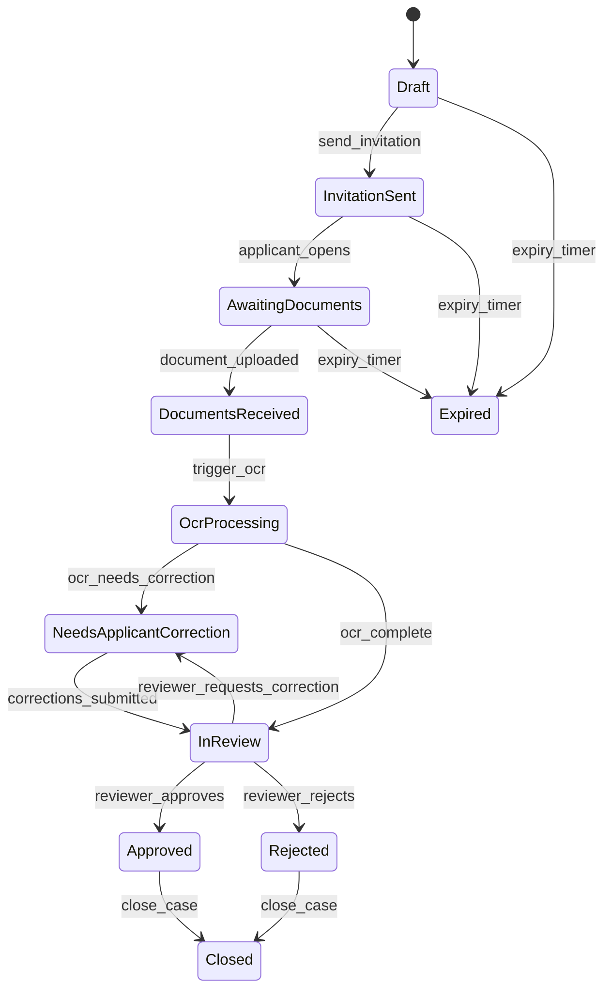

# CKYC Marketplace — Multi-Tenant KYC Case Management MVP

> Build an MVP for a multi-tenant electronic marketplace application with merchant onboarding and KYC case management.

## Product Context

The application is for an electronic marketplace. Marketplace businesses can buy and sell from one another. A laptop seller may buy bags from a bag seller; the bag seller may buy laptops from the laptop seller and resell them. Therefore:

- A business has one tenant/business account, but its buyer and seller roles are specific to a transaction.
- Do not assign a permanent buyer-only or seller-only role to a business.
- A person who represents a business is not necessarily the business itself.
- The applicant, the business being checked, the tenant requesting a check, and the user reviewing the check may be different entities.

The product should support business onboarding, person/business KYC cases, secure document submission, OCR-assisted review, optional email-based document intake, controlled sharing of selected verification results, tenant administration, subscription/usage tracking, and audit history.

> [!IMPORTANT]
> This is a **case and document workflow MVP**. Do not claim that it provides legal compliance, performs authoritative government-ID verification, or replaces an approved identity-verification provider. OCR is extraction assistance only; it must never automatically approve a case.

---

## MVP Scope & Priorities

### Phase 1 — Core Flow (Build This First)

The golden path that must work end-to-end before anything else:

```
Tenant Admin creates case → Applicant receives invitation → Applicant uploads document
→ OCR produces draft fields → Reviewer confirms or requests corrections
→ Applicant consents to share selected fields → Recipient tenant sees approved share
```

| Feature | Priority | Notes |
|---|---|---|
| Auth (login, JWT/cookie, RBAC) | P0 | HTTP-only cookies, CSRF protection |
| Multi-tenant data isolation | P0 | PostgreSQL RLS + application-level filters |
| KYC Case CRUD + status machine | P0 | 10 statuses, state transition validation |
| Document upload (portal) | P0 | MinIO private storage, file validation |
| Mock OCR adapter | P0 | Returns sample extracted fields for dev |
| Reviewer workspace | P0 | Confirm/correct/reject OCR fields |
| Applicant invitation + portal | P0 | Secure token-based access |
| Share consent workflow | P0 | Applicant approves/declines field sharing |
| Audit trail | P0 | Log all sensitive reads and writes |
| Tenant dashboard | P0 | Case list, filters, metrics |
| Docker Compose dev environment | P0 | All services running locally |

### Phase 2 — Enhanced Features (After Core Works)

| Feature | Priority | Notes |
|---|---|---|
| Email document intake | P1 | Mock adapter, `.eml` import for dev |
| Subscription & usage tracking | P1 | Simple plan + counters, no billing integration |
| Platform admin tenant management | P1 | Create/list tenants, view usage |
| Configurable document types | P1 | No hard-coded jurisdiction rules |
| Configurable retention/deletion | P2 | Cases, documents, shares |
| Real OCR provider adapter | P2 | Tesseract or cloud API behind adapter |
| Production email integration | P2 | IMAP with OAuth2 credentials |
| Malware scanning interface | P2 | Pluggable, fail-safe |

### Explicitly Out of Scope for MVP

- Payment/billing provider integration
- AI/ML automated risk scoring
- Complex multi-tier approval workflows (4-eyes)
- Visual entity relationship graphs
- Automated SAR/STR filing
- Mobile native app
- Real government ID verification
- Cross-tenant applicant merging

---

## Technology Stack

### Backend
| Component | Technology | Version/Notes |
|---|---|---|
| Framework | Python + FastAPI | 3.11+, async-first |
| Validation | Pydantic v2 | Request/response schemas |
| Database | PostgreSQL 15+ | Row-Level Security (RLS) |
| ORM | SQLAlchemy 2.x | Async with `asyncpg` |
| Migrations | Alembic | With RLS policy management |
| Task Queue | Redis + Celery | OCR processing, email jobs |
| Object Storage | MinIO | S3-compatible, SSE encryption |
| Auth | `python-jose` + `passlib` | JWT in HTTP-only cookies |
| CSRF | Custom middleware | Double-submit cookie pattern |

### Frontend
| Component | Technology | Notes |
|---|---|---|
| Framework | React 18+ with TypeScript | Strict mode |
| Build Tool | Vite | Fast dev server |
| Routing | React Router v6 | Nested layouts |
| Server State | TanStack Query v5 | Caching, optimistic updates |
| Forms | React Hook Form + Zod | Validation |
| UI Components | Radix UI + Tailwind CSS | Accessible, customizable |
| HTTP Client | `ky` or `fetch` wrapper | Typed API client |

### Infrastructure
| Component | Technology | Notes |
|---|---|---|
| Orchestration | Docker Compose | All services |
| API Docs | FastAPI OpenAPI | Auto-generated |
| Task Monitor | Flower (optional) | Celery dashboard |

---

## Project Structure

```
/backend
  /app
    /api
      /v1
        /endpoints        # Feature-grouped routers
        api.py            # Router aggregator
    /core
      config.py           # Pydantic Settings
      database.py         # Engine, session, RLS context
      security.py         # JWT, password hashing, CSRF
    /models               # SQLAlchemy models (with TenantMixin)
    /schemas              # Pydantic request/response schemas
    /services             # Business logic layer
    /workers              # Celery tasks
    /storage              # MinIO abstraction (adapter pattern)
    /email                # Email adapter interface + mock
    /ocr                  # OCR adapter interface + mock
  /migrations             # Alembic (including RLS policies)
  /tests
    /unit                 # Service logic tests
    /api                  # HTTP endpoint tests
    /integration          # Cross-tenant isolation tests
  main.py
  celery_app.py
  requirements.txt
  Dockerfile

/frontend
  /src
    /api                  # TanStack Query hooks, query key factories
    /components           # Reusable UI components
    /features             # Domain-grouped features
      /auth
      /cases
      /documents
      /dashboard
      /sharing
      /applicant-portal
    /layouts              # Page layouts
    /pages                # Route-level pages
    /lib                  # Utilities, types
  package.json
  vite.config.ts
  tsconfig.json
  Dockerfile

/infra
  docker-compose.yml
  docker-compose.override.yml
  .env.example
  init-scripts/           # DB init, MinIO bucket setup

/docs                     # Supplementary documentation
  architecture.md
  api-patterns.md
  data-model.md
  security-guide.md
  mvp-implementation-plan.md
```

---

## Roles and Permissions

Implement these roles with strict backend enforcement:

### 1. Platform Administrator
- Can create and list marketplace tenants
- Can view tenant status, subscription plan, and aggregate usage
- Does **not** automatically receive unrestricted access to identity documents
- Any exceptional document access must be explicitly granted and audited

### 2. Tenant Administrator
- Can manage users and cases for their own tenant
- Cannot access another tenant's cases or documents

### 3. Reviewer
- Can review cases assigned to them within their tenant
- Can confirm, correct, or reject OCR-extracted fields
- Must enter a reason for a final approval or rejection

### 4. Applicant
- Can access only the case reached through their invitation
- Can submit documents, correct permitted fields, see status, and approve or decline a proposed data share

### 5. Recipient
- Can see only fields explicitly shared with its tenant, for the stated purpose and within the allowed time

> [!CAUTION]
> Enforce permissions and tenant boundaries on **every** backend endpoint and storage access. Do not rely on frontend visibility or route protection as authorization. Add tests proving a user in tenant A cannot access tenant B's cases, documents, or shares.

**Authentication approach:**
- Use `python-jose` for JWT token creation/verification
- Use `passlib[bcrypt]` for password hashing
- Store JWT in secure HTTP-only cookies with `SameSite=Lax`
- Implement CSRF protection via double-submit cookie pattern
- Do NOT store tokens in browser `localStorage`

---

## Core Data Model

Create appropriate models, constraints, and migrations for:

| Model | Key Fields |
|---|---|
| **Tenant** | name, status, plan, created_at |
| **User** | email, hashed_password, is_active, is_platform_admin |
| **TenantMembership** | user_id, tenant_id, role (enum), status |
| **Applicant** | tenant_id, applicant_type (person/business), profile fields |
| **BusinessRepresentative** | person_id, business_id, role, verification_status |
| **KycCase** | tenant_id, applicant_id, purpose, case_type, status (enum), reviewer_id, dates |
| **CaseDocument** | case_id, doc_type, storage_key, filename, file_hash, source (enum), upload_date, review_status |
| **ExtractedField** | document_id, field_name, draft_value, source_page, applicant_confirmed, reviewer_decision, correction_history (JSONB) |
| **ShareGrant** | source_case_id, requesting_tenant_id, recipient_tenant_id, purpose, selected_fields (JSONB), consent_status, consent_date, expiry, revocation_date |
| **AuditEvent** | actor_id, tenant_id, object_type, object_id, action, timestamp, metadata (JSONB) |
| **MailIngestionRecord** | message_ref, case_id, processing_status, attachment_status, error_details |
| **Subscription** | tenant_id, plan, period_start, period_end |
| **UsageRecord** | tenant_id, metric (cases/documents/reviews), count, period |

> [!WARNING]
> Do not create a global automatically linked identity profile across tenants. Cross-tenant sharing must be explicit and case-specific. Do not automatically merge applicants because their names, email addresses, or document fields look similar.

---

## Case Workflow & Status Machine

Support individual and business cases. For business cases, keep the business and its representatives as distinct records.

### Status Transitions



### Rules
- A reviewer must make the final approval or rejection decision
- OCR-extracted data must be marked as **unverified** until reviewed
- Record the reviewer, timestamp, decision, and reason
- Make case purpose visible to the applicant
- Allow configurable document types (trade licenses, ID documents, etc.)
- Do not hard-code one jurisdiction's rules

---

## Tenant Administration & Dashboard

Build:

- **Platform-admin** tenant list: status, plan, created date, aggregate usage
- **Tenant dashboard**: cases for that tenant only
- **Case search & filtering**: by status, applicant/business, document type, reviewer, date range
- **Case detail page**: documents, draft OCR fields, review history, share status
- **User & membership management** for tenant admins
- **Usage totals**: cases, documents, reviews
- Clear loading states, validation errors, empty states, and processing indicators

Add simple subscription-plan and usage tracking. Do NOT store payment-card data or implement billing-provider integration. Leave a documented integration point for hosted billing checkout later.

---

## Applicant Portal & Document Upload

### Invitation Flow
1. Tenant admin creates case and triggers invitation
2. System generates a short-lived, case-specific token (hashed in DB)
3. Applicant receives link (or simulated notification in dev)
4. Applicant authenticates via token → sees case context

### Applicant Can:
- See which tenant requested information and the stated purpose
- Upload documents to the correct case
- See upload and review status
- Correct permitted information extracted by OCR
- Approve or decline a proposed share of selected verification details

### Upload Requirements
- Accept only configured formats: PDF, JPEG, PNG
- Enforce configurable file-size limits (default: 10MB)
- Validate file content via magic bytes, not just filename/MIME type
- Store documents privately in MinIO; never expose public URLs
- Use short-lived, case-specific pre-signed download URLs (5 min expiry)
- Add malware-scanning interface; fail safely if unavailable
- Do NOT send document contents to logs, analytics, or error reporting
- Do NOT use real identity documents in tests or demos

---

## OCR-Assisted Review

Implement OCR behind an **adapter pattern** so the service can be swapped.

### Mock OCR (For Development)
- Returns configurable sample extracted fields for any document
- Simulates processing delay (1-3 seconds via Celery task)
- Returns mock confidence scores

### OCR Rules
- Extract fields as **drafts only**
- Show extracted value alongside its source document/page
- Allow applicants or reviewers to correct fields according to role
- Keep a history of changes and review decisions (JSONB `correction_history`)
- Do NOT automatically approve/reject based on OCR output
- Do NOT send documents to external OCR unless explicitly configured

### Processing Pipeline
```
Upload → Validate → Store in MinIO → Enqueue Celery Task
→ OCR Extract (mock/real) → Save ExtractedFields → Update Case Status
→ Notify Reviewer
```

---

## Email Document Intake (Phase 2)

The secure portal is the canonical case record. Email is an optional intake and notification channel.

### Requirements
- Implement an email-adapter interface (protocol/ABC)
- Dev mode: mock email or `.eml` file import (no real mailbox needed)
- Production: dedicated KYC mailbox only, credentials via env vars
- Match messages to cases using a **case reference** (e.g., `[CASE-XXXX]` in subject)
- Ambiguous matches → exception queue (never guess)
- Validate attachment type/size; store in private storage
- Mark email documents as **pending review**
- Do NOT treat sender address as identity proof
- Configurable retention/deletion for message copies

---

## Controlled Sharing

### Workflow
1. Recipient tenant requests selected fields and states a purpose
2. Applicant sees: requesting tenant, purpose, fields, expiry
3. Applicant approves or declines
4. (Optional) Source tenant also approves
5. Recipient sees **only** explicitly approved fields + review status/date
6. Grant can expire or be revoked
7. All events logged in audit trail

### Rules
- Share **reviewed verification claims** by default, not raw document images
- Recipient cannot browse source case or access unshared documents
- Shared result ≠ automatic approval by recipient
- Recipient decisions stay separate from source case decisions

---

## Audit, Security & Data Handling

### Authentication & Authorization
- JWT in HTTP-only cookies with CSRF protection
- Rate limiting on invitation and upload endpoints (use `slowapi` + Redis)
- Tenant-scoped authorization on every data endpoint
- Short-lived invitation/sharing tokens (hash stored, not plaintext)

### Document Security
- Encrypt documents in MinIO (SSE-S3 or SSE-KMS)
- HTTPS enforced in production
- Pre-signed URLs with 5-minute expiry for downloads

### Logging & Privacy
- Do NOT log: passwords, tokens, full ID numbers, document contents, OCR text
- Audit sensitive reads and writes with minimal metadata
- Keep encryption keys and credentials out of source code and database

### Data Lifecycle
- Configurable retention/deletion for cases, documents, email records, shares
- Document backup and restore procedures

### Required Tests
- Tenant isolation (user A cannot access tenant B data)
- Role permissions (reviewer cannot create tenants)
- Secure sharing (expiry, revocation, unauthorized access)
- Document access (no public URLs, proper pre-signed URL auth)

---

## User Interface Pages

| Page | Roles |
|---|---|
| Login + tenant selection | All |
| Platform admin tenant list | Platform Admin |
| Tenant dashboard + case list | Tenant Admin, Reviewer |
| Case creation + invitation | Tenant Admin |
| Case detail + reviewer workspace | Reviewer |
| Applicant document upload + consent | Applicant |
| Recipient share-view | Recipient |
| Usage/plan view | Tenant Admin |

Clear labels distinguishing: **"OCR Draft"** → **"Applicant Confirmed"** → **"Reviewed"** → **"Shared"**

All sensitive API access authorized by the backend — frontend route guards are UX only.

---

## Tests & Delivery

### Required Deliverables
- [ ] Database migrations (Alembic, including RLS policies)
- [ ] Unit tests: case status transitions, OCR field correction, email routing, share consent/expiry/revocation, usage counting
- [ ] API tests: authentication, role permissions, tenant isolation, document access
- [ ] Frontend tests: applicant upload flow, reviewer workspace flow
- [ ] Synthetic seed data (fictional businesses and cases only)
- [ ] Docker Compose for local development
- [ ] README: setup, env vars, migrations, tests, OCR config, email config, storage config, deployment notes
- [ ] Known limitations and recommended next steps

### Implementation Process

1. **Inspect** the repository and report existing structure
2. **Plan** a short implementation plan with assumptions
3. **Implement** the MVP in small, testable steps
4. **Prioritize** the golden path flow (Phase 1)
5. **Then** add email intake through the same case/document workflow

---

## Supporting Documentation

See the `/docs` directory for detailed guides:

- [`architecture.md`](docs/architecture.md) — System architecture, component diagram, data flow
- [`api-patterns.md`](docs/api-patterns.md) — FastAPI patterns, multi-tenancy, auth implementation
- [`data-model.md`](docs/data-model.md) — Complete ERD, model details, RLS policies
- [`security-guide.md`](docs/security-guide.md) — Auth, encryption, audit, threat model
- [`mvp-implementation-plan.md`](docs/mvp-implementation-plan.md) — Sprint-by-sprint build plan
